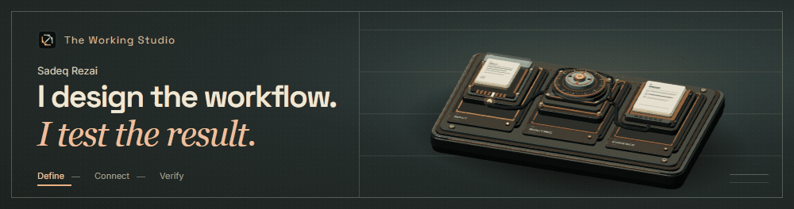
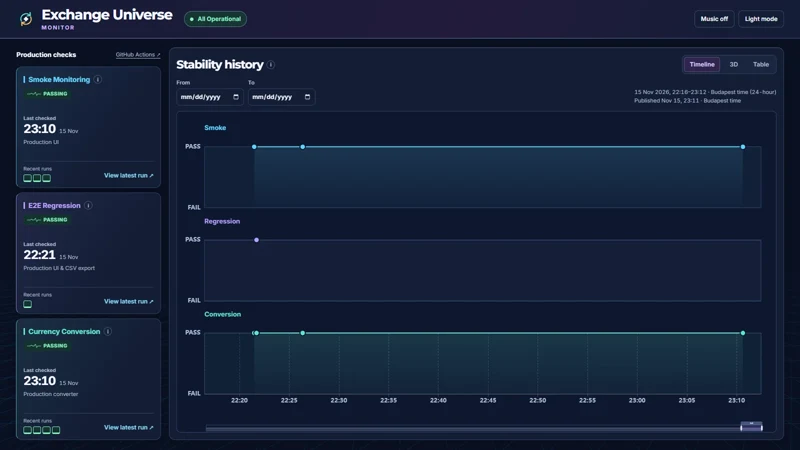
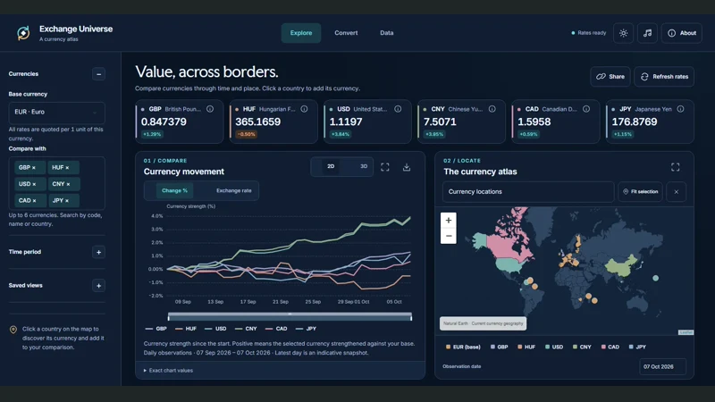
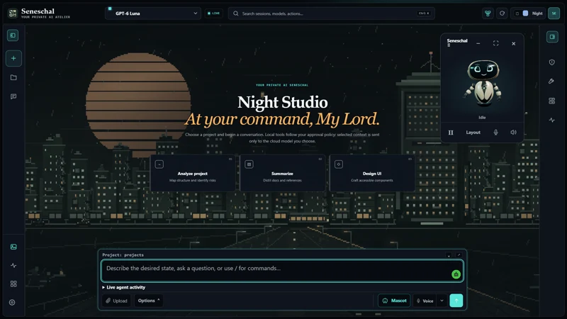
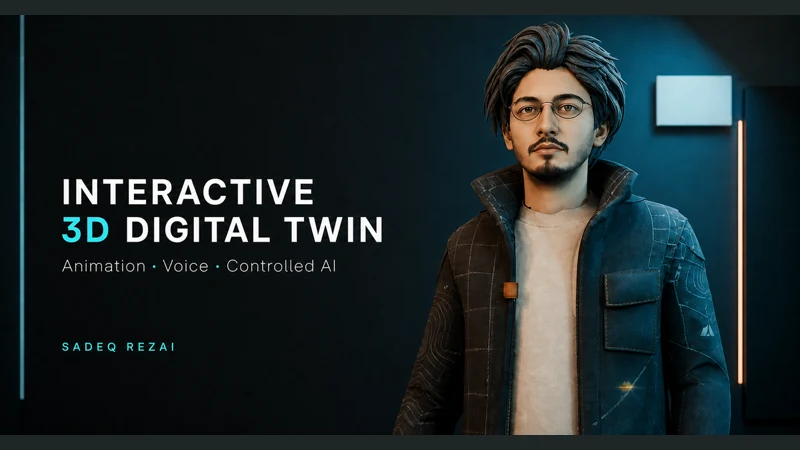

<h1>Sadeq Rezai</h1>

<picture><source media="(prefers-reduced-motion: reduce)" srcset="assets/profile-opening.webp"></picture>

<strong>Technology implementation &amp; automation specialist</strong> 
I configure software, design browser and API checks, and build data tools. I use AI to help implement projects; I define the workflow, connect the pieces and verify the result.

Budapest, Hungary · Open to implementation, QA automation and data-tooling roles. 
<a href="https://rammeshgar.github.io/">Portfolio</a> · <a href="https://www.linkedin.com/in/sadeqrezai/">LinkedIn</a> · <a href="mailto:rezaisadeq0@gmail.com">Email</a>

<h2>Selected projects</h2>

Exchange Universe and its monitor are separate projects: one to explore currencies, the other to check the live app. The screenshots show captured runs and rates.

<table width="100%">
  <tr>
    <td width="50%" valign="top">
      
      <h3>Exchange Universe Monitor (QA automation)</h3>
      Playwright smoke and regression checks include doubling the EUR input to verify the HUF result. Published runs link to GitHub Actions and available screenshots. Optional email alerts cover failures and recovery.  
      <a href="https://rammeshgar.github.io/exchange-universe-monitor/">Live dashboard</a> · <a href="https://github.com/Rammeshgar/exchange-universe-monitor">Source</a> · <a href="https://rammeshgar.github.io/exchange-universe-monitor-case/">Case study</a>
    </td>
    <td width="50%" valign="top">
      
      <h3>Exchange Universe (currency atlas)</h3>
      An R/Shiny app for currency history, comparison and conversion. Selecting a country on the Leaflet map changes the currency selection. Saved rates and queued requests limit unnecessary provider calls.  
      <a href="https://sadeq.shinyapps.io/exchange_universe/">Live application</a> · <a href="https://github.com/Rammeshgar/Exchange_Universe_shiny">Source</a> · <a href="https://rammeshgar.github.io/exchange-universe/">Case study</a>
    </td>
  </tr>
</table>

<h3>Seneschal (AI agent workspace)</h3>

A public Windows/WSL beta built on OpenCode. Its agent board manages task dependencies and handoffs, shows which tools need approval, and keeps history locally. The workspace includes an optional 3D companion. A model provider is required for AI work.

<a href="https://github.com/Rammeshgar/seneschal/releases">Beta releases</a> · <a href="https://github.com/Rammeshgar/seneschal">Source</a> · <a href="https://rammeshgar.github.io/seneschal/">Case study</a>

 

<h2>Studio lab</h2>

<table width="100%">
  <tr>
    <td width="50%" valign="top">
      
      <h3>Interactive Digital Twin (3D assistant)</h3>
      A browser character answers questions about my work by voice or text. Text stays available when 3D or speech cannot load.  
      <a href="https://rammeshgar.github.io/digital-twin-demo/">Live demo</a> · <a href="https://github.com/Rammeshgar/digital-twin-demo">Source</a> · <a href="https://rammeshgar.github.io/digital-twin/">Case study</a>
    </td>
    <td width="50%" valign="top">
      
      <h3>Afterlight (Windows wallpapers)</h3>
      Nine interactive pixel-art worlds with day and night lighting and clickable scenery. Classic and Cinema have separate installers.  
      <a href="https://github.com/Rammeshgar/afterlight/releases">Download</a> · <a href="https://github.com/Rammeshgar/afterlight">Source</a> · <a href="https://rammeshgar.github.io/afterlight-case/">Case study</a>
    </td>
  </tr>
</table>

<h2>Background</h2>

At FRAIA (Apr 2025–Sep 2026), a small AI startup, I worked on client requirements, software configuration, browser and API validation, mobile prototypes and client websites. My earlier work at Peroptyx (Jul 2024–Jul 2025) was in data analysis.

R is the language I have the most direct experience with. I also have practical SQL and Python knowledge. For many of my web and desktop projects, I use AI-assisted development and take responsibility for the workflow, integration and checks.

